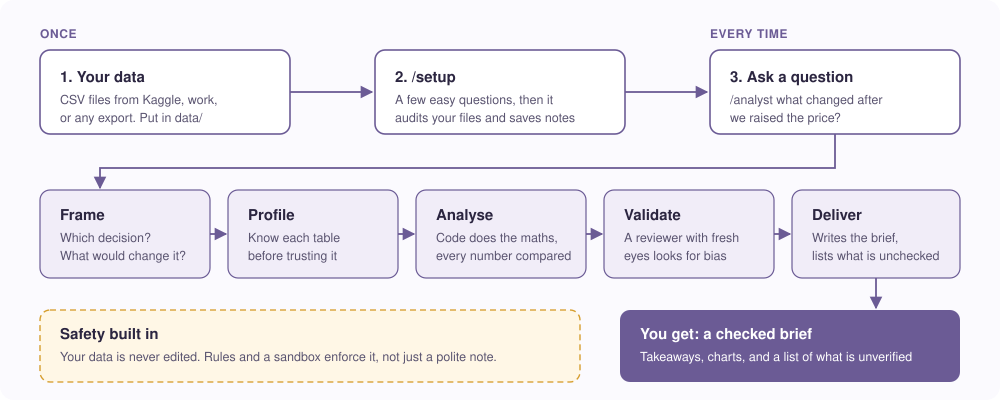

# ✧ Your Own AI Analyst

**Drop in your data, ask a business question in plain words, and get a checked brief with charts. It runs inside Claude Code on your own computer.**

You bring CSV files (from Kaggle, from work, from any export). It asks a few easy questions, checks your files for problems, and then answers questions like *"what happened to sales after we changed the price?"*. Every number comes from code you can rerun, every result is compared with something, and the brief ends with a list of what was **not** verified. Your data stays on your machine and is never edited.

> **Not a chatbot.** The steps, the file names and the checks are fixed, so the same question gives the same kind of answer each time.

---

## Start (10 minutes, no coding needed)

> **Using Claude or another AI assistant?** Point it at this repo and say
> *"set up my analyst"*. The [AGENTS.md](AGENTS.md) file tells it what to do.

You need [Claude Code](https://claude.com/claude-code), Python 3.10 or 3.11, and [Poetry](https://python-poetry.org).

1. **Get the repo.** `git clone https://github.com/vsancnaj/your-own-ai-analyst.git` then `cd your-own-ai-analyst`
2. **Install.** `poetry install`
3. **Open Claude Code here.** Type `claude`
4. **Type `/setup`.** Answer the easy questions, copy your CSV files into `data/` when it asks, and let it check them.
5. **Ask.** `/analyst <your question>`

You will find each answer in a folder under `outputs/`, with `brief.md` as the thing to read.

**What it needs from you:** the CSV files, a rough idea of what the data is, and the decision your question feeds. If you do not know something, pick "I don't know". It will measure what it can and mark the rest as a guess.

**What it will not do:** invent a question, edit your data, or present a guess as a fact.

---

# For agents (Claude Code and others)

Everything below is for the AI reading this repo. A human can stop here.

## How to behave
1. If `knowledge/context.md` is missing, run `/setup`. Nothing else works without it.
2. Read [AGENTS.md](AGENTS.md) first: layout, conventions, and the file-name contract.
3. Business question: `/analyst <question>`. The chain is frame, profile (tables without notes), analyse, validate, deliver.
4. Never answer a table question from column names alone, never print raw rows, never edit `data/`.

## The chain and its files
| Skill | Reads | Writes |
|---|---|---|
| `setup` | user answers, `data/` | `knowledge/context.md`, `quirks.md`, `corrections.md`, `tables/` |
| `frame` | question, `knowledge/` | `outputs/<run>/frame.md` |
| `profile` | one CSV, `quirks.md` | `knowledge/tables/<table>.md` |
| `analyse` | `frame.md`, `knowledge/`, `data/` | `analysis.py`, `data/`, `charts/` in the run folder |
| `validate` | the run folder | `review.md` (Ship it, Think on it, Fix first) |
| `deliver` | `review.md` first, then the run folder | `brief.md` |

File names are the only contract between skills. The model decides what to compute; code in `helpers/` computes it.

## Advice versus enforcement
| Rule | Enforced by | Note |
|---|---|---|
| Never edit `data/` | `Edit(/data/**)` deny rule, sandbox write block on `data/` | The sandbox block needs testing on your Claude Code version. |
| No deleting files | deny rules on `rm`, `rmdir`, `git clean` | Bash rules match the usual command text only. A script can still delete files; the sandbox is what blocks that. |
| Skills that must not edit | `disallowed-tools: Edit` in `frame`, `validate`, `deliver` | `Write` is still needed to produce their output files. |
| Aggregates only, no raw rows | a line in `AGENTS.md` and the `validate` check | Cannot be enforced by a rule. |
| Quirks only from a human | `AskUserQuestion` in `setup` and `profile` | Cannot be enforced by a rule. |

Lines explain and rules enforce. Where a rule cannot enforce something, this table says so.

## Works with
Built for Claude Code. Other agents that read `AGENTS.md` can follow the method, but `/setup`, the skills and the permission rules are Claude Code features.

## Known limits
- Reads CSV only. Date columns are found from their values; Unix-timestamp numbers are not detected.
- Quirks and "today" are only as good as the user's answers; both are marked confirmed or inferred.
- Not yet tested on a real user's data. See the test notes when they exist.
